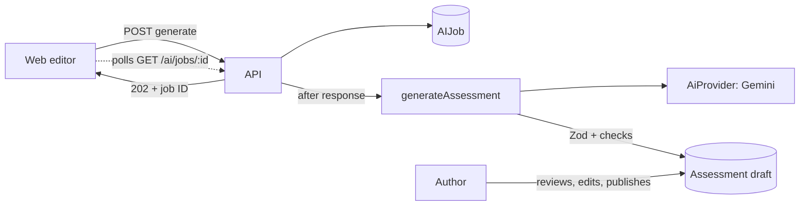

# Assessments and AI generation

Milestone 6 covers **creating** assessments, by hand or with AI. Taking them, submissions, evaluation and verified scores are not built (Milestone 7).

## How it fits together

- Generation returns **202 and a job ID at once**. The AI call runs after the response is sent (Next.js `after`), and clients poll. No browser request ever waits on the provider.
- This is **not a durable queue**. If the API process stops mid-job, the job is marked failed (`timeout`) the next time anyone reads it. A real worker is a later infrastructure decision.
- AI output only ever becomes a **draft**. Publishing is a separate request by a person, and every publication writes an `assessment.published` audit record in the same transaction.

## Data model (additive migration `20261105100000_assessment_generation`)

No existing column, enum, trigger or constraint changed. New nullable columns:

| Table | Added |
|---|---|
| `assessment_versions` | `assessment_type` (`KNOWLEDGE`, `PRACTICAL`, `SCENARIO_BASED`), `ai_job_id` |
| `assessment_questions` | `explanation`, `skill_id`, `difficulty`, `estimated_minutes` |
| `assessment_rubric_criteria` | `max_score`, `scoring_guidance`, `skill_id` |
| `ai_jobs` | `input` (≤16 KB), `assessment_id` |

Also: indexes on `ai_jobs(requested_by_id, created_at)` and `(company_id, created_at)` (the second replaces the old single-column index), CHECK constraints on the new columns, and a partial unique index allowing **one open draft per assessment**.

Existing statuses are kept: the prompt's PENDING/COMPLETED are `QUEUED`/`SUCCEEDED` here.

### Question kinds

The six author-facing kinds map onto the existing `QuestionType`, with a `kind` discriminator inside the JSON, validated by Zod on every read and write:

| Kind | `QuestionType` | `options` (candidate-facing) | `answerKey` (private) |
|---|---|---|---|
| `multiple_choice` | `SINGLE_CHOICE` | choices | correct choice |
| `multiple_select` | `MULTIPLE_CHOICE` | choices | correct choices |
| `true_false` | `SINGLE_CHOICE` | – | correct boolean |
| `short_answer` | `SHORT_TEXT` | – | expected criteria |
| `scenario` | `LONG_TEXT` | scenario text | expected criteria |
| `practical_task` | `LONG_TEXT` | requirements, deliverables | evaluation criteria |

Only objective kinds carry an `explanation`. `CODE` and `FILE_UPLOAD` are never produced, and nothing a candidate submits is ever executed.

Rubric criteria have no position column, so they are listed by `key`.

## Rules

- **Drafts are editable; published versions are not.** The database triggers from the core migration enforce this for versions, questions, skills, rubrics and criteria. Editing a published assessment means `POST /assessments/:id/draft`, which copies the latest version into version N+1.
- **Rubric weights total exactly 100** (compared in hundredths). The database checks again when a rubric is published.
- **Skill weights** are recomputed at publish from how many questions measure each skill. Every selected skill needs at least one question.
- **Content safety.** The prompt forbids sensitive personal questions, protected-characteristic criteria, certification claims, invented references and code execution. A pattern screen (`findUnsafeText`, English and Albanian) rejects generated text that asks for such details and blocks publishing hand-written text that does. It is a backstop, not a guarantee: a person reviews everything.
- **No scores.** Generated rubrics describe how answers are judged. Nothing here writes to `VerifiedSkillScore`, and unknown fields in AI output are dropped by the schemas.

## Permissions

| Action | Roles |
|---|---|
| Read assessments, rubric, versions, preview, jobs they started | any active member (`OWNER`, `ADMIN`, `RECRUITER`, `REVIEWER`, `VIEWER`) |
| Create, edit, generate, publish, restore, cancel/retry own jobs | `OWNER`, `ADMIN`, `RECRUITER` |
| Delete (soft) | `OWNER`, `ADMIN` |
| Read any company's assessments | platform `ADMIN`/`SUPER_ADMIN` (read only) |
| Read others' jobs in the company | `OWNER`, `ADMIN` |

Routes with an assessment ID but no company resolve the owner from the database, then run the usual membership check. A missing, deleted, foreign or platform-owned assessment all return the same 403.

## AI generation

- `packages/ai`: `AiProvider` (`generateJson`), `GeminiProvider`, prompt builders, `generateAssessment` / `regenerateQuestion`. Swap providers by changing `apps/api/src/lib/ai/provider.ts`.
- Output is parsed, validated with `generatedAssessmentSchema`, and checked against the request (question count, known skills, every skill covered, kinds fit the type, content safety). A rejected answer triggers a repair prompt that carries **problem codes only**, never the rejected content. Total provider calls per job are capped (`GENERATION_MAX_PROVIDER_ATTEMPTS`, default 3). Transient errors (timeout, 5xx, 429) back off briefly; permanent ones (bad key, blocked) stop at once.
- Limits (env, with defaults): 10 jobs per user and 40 per company per 24 hours (failed jobs count, since they may have spent tokens), 3 jobs running per company, 90 s per provider call, 2 manual retries per job, ≤30 questions, ≤8 skills, ≤1000 characters of extra instructions.
- **Idempotency.** `Idempotency-Key` (8–100 chars) is scoped to company and user. Same key and input returns the same job (`reused: true`); same key with different input is `409`. Without a header, an identical request within five minutes is treated as an accidental repeat.
- **Cancel.** A queued or running job can be cancelled. A result that arrives afterwards is discarded, but its token usage is recorded.
- **Secrets.** `GEMINI_API_KEY` is read only in the API, sent only as a request header, and never appears in errors, logs, job rows or responses. Provider messages are never copied anywhere: jobs store a stable code (`provider_timeout`, `invalid_output`, …) with fixed text.
- **Cost.** Input and output tokens are stored per job. `estimated_cost` is filled when `GEMINI_*_PRICE_PER_MILLION` are set; it is an estimate, not an invoice.

## Endpoints

All under `/api/v1`, all need a bearer token, all answer `{ success, data }` or `{ success: false, error }`. Request bodies are validated with `@skillprove/validation` schemas.

| Method and path | Role | Notes |
|---|---|---|
| `GET /companies/:companyId/assessments` | read | `?page&pageSize(≤50)&status` |
| `POST /companies/:companyId/assessments` | author | manual empty draft, 201 |
| `POST /companies/:companyId/assessments/generate` | author | 202 `{ job, reused }`, `Idempotency-Key`, 429 `RATE_LIMITED`, 503 without a provider key |
| `GET /assessments/:id` | read | author view with answer keys |
| `PUT /assessments/:id` | author | draft details, needs `expectedUpdatedAt`; 409 if stale or published |
| `DELETE /assessments/:id` | delete | soft delete |
| `POST /assessments/:id/draft` | author | new draft from latest version (201), or existing draft (200) |
| `GET /assessments/:id/preview` | read | candidate-facing view, no answers |
| `POST /assessments/:id/questions` | author | one question, 201 |
| `PUT` / `DELETE /assessments/:id/questions/:questionId` | author | |
| `PUT /assessments/:id/questions/reorder` | author | `{ questionIds }`, must list all |
| `POST /assessments/:id/questions/:questionId/regenerate` | author | 202 job; replaces the question in the open draft |
| `GET` / `PUT /assessments/:id/rubric` | read / author | weights total 100 |
| `GET /assessments/:id/versions` | read | newest first |
| `POST /assessments/:id/publish` | author | 400 with issue keys if not ready |
| `POST /assessments/:id/versions/:versionId/restore` | author | copies into a new draft; 409 if a draft is open |
| `GET /ai/jobs/:jobId` | requester or company admin | poll |
| `POST /ai/jobs/:jobId/retry` | requester or admin, authoring role | failed jobs only, capped |
| `POST /ai/jobs/:jobId/cancel` | same | |

Job responses contain only: id, status, assessment ID, retry count, error code, token counts and timestamps.

## Clients

- **Web** (`/assessments`): dashboard, five-step wizard (basics, skills, level and type, duration and size, AI or manual), generation progress by polling, and the editor with details, questions (add, edit, reorder, remove, regenerate), rubric, candidate preview and version history. Wizard steps 6 and 7 (review and edit, save or publish) are the editor itself.
- **Mobile**: read-only. List, details with status and versions, and generation status. Company members create and edit on the website.

## Known limitations

- Generation runs in the API process, not a worker; a crash leaves a job to be failed as stale.
- Real Gemini output has **not been exercised**: tests use a deterministic mock, and the adapter is tested against a fake `fetch`. Verify with a real key before relying on it.
- Skill weights on a draft are placeholders (equal) until publish.
- Rubric criteria are ordered by key.
- Content screening is pattern-based and can miss things or flag harmless text.
- iOS and Android devices were not exercised.
