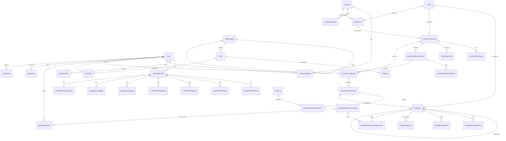

# Database

PostgreSQL through Prisma. All schema and client code lives in `packages/database`.

## Current Neon setup

| Environment | Database | Status |
|---|---|---|
| Development | Neon branch `main` | In use, migrated |
| Test | Separate Neon branch `test`, or a local or CI PostgreSQL | The Neon branch does not exist yet |
| Production | Not created | Use a separate Neon project, not a branch of `main` |

**`main` is the development database, despite its name.** It is not production. Automated tests must never run against it, or against production. **Create a separate test branch before running integration tests on Neon**, because those tests write to and delete from the database they target.

## Environment files

Each file is gitignored. Only the `.env.example` files are committed.

| File | Variables | Read by |
|---|---|---|
| `packages/database/.env` | `DATABASE_URL`, `DIRECT_URL` | Prisma CLI |
| `apps/api/.env.local` | `DATABASE_URL`, `CORS_ALLOWED_ORIGINS` | API |
| `apps/web/.env.local` | `NEXT_PUBLIC_API_URL` | Web |
| `apps/mobile/.env` | `EXPO_PUBLIC_API_URL` (optional in development) | Mobile |

- A `.env` file in the repository root is not read by any app. The test guard does read one, so that its URLs stay protected.
- `DATABASE_URL` is Neon's pooled connection. `DIRECT_URL` is the direct one (pooler off), used for migrations.
- End both Neon URLs with `sslmode=verify-full`, which is confirmed to work with `pg` and with Prisma Migrate.
- Variables already set in the shell take priority over `packages/database/.env`.

## Connect Neon

1. Copy the pooled and direct connection strings from Neon's **Connect** dialog.
2. Fill in the first two files in the table above, using their `.env.example` files as templates.
3. Run `pnpm db:migrate:deploy`, then `pnpm db:migrate:status`.
4. Run `pnpm db:seed` to load the skill taxonomy. Without it, the skill picker is empty and every search says "No skills match your search". It is safe to repeat (see [Seed data](#seed-data)). Repeat steps 3 and 4 whenever you pull new migrations or seed data.
5. Start the API and open `http://localhost:4000/api/v1/health/ready`. It should return `"database":"connected"`.

## Test database safeguards

`packages/database/src/test-database-guard.ts` runs before the database tests connect to anything. Tests are skipped when `TEST_DATABASE_URL` is unset. When it is set, the run fails unless one of these applies:

- **Local:** the host is `localhost`, `127.0.0.1` or `::1`. CI's throwaway PostgreSQL is in this group.
- **Neon test branch:** all of these are true:
  - The host is on `neon.tech`.
  - The endpoint differs from every `DATABASE_URL` and `DIRECT_URL` in the shell and in the root `.env`, `packages/database/.env` and `apps/api/.env.local`.
  - `TEST_NEON_BRANCH_ID` is set, and the server confirms that it is the connected branch.

Never set `TEST_NEON_BRANCH_ID` to the ID of `main` or production. The guard cannot know what an ID means, so on a machine with no env files naming those endpoints, this is the one mistake that would get through.

The guard covers tests only. `pnpm db:migrate:deploy` applies migrations wherever `DIRECT_URL` points, so check the target first.

## Create the Neon test branch

1. In Neon, create a branch named `test` with `main` as its parent.
2. Reset the role's password on `test` if Neon allows it, so that its credentials do not also work on `main`.
3. Copy its direct connection string and its branch ID (`br-...`). Check that the endpoint differs from the one for `main`.
4. In one terminal session, without saving the URL to a file that Git tracks:

   ```powershell
   $env:DIRECT_URL = "<test direct URL>"
   pnpm db:migrate:deploy
   $env:TEST_DATABASE_URL = $env:DIRECT_URL
   $env:TEST_NEON_BRANCH_ID = "<test branch ID>"
   pnpm test
   ```

## CI

CI uses a throwaway PostgreSQL 18 service, matching Neon's major version, and holds no Neon credentials. Keep the URLs for `main` and production out of CI.

## Local database with no Docker or PostgreSQL

Prisma can run a small local Postgres server:

```sh
cd packages/database
pnpm exec prisma dev --name skillprove --detach
```

Use the printed `postgres://` URL for `DIRECT_URL` and `TEST_DATABASE_URL` in your shell. Stop it with `pnpm exec prisma dev stop skillprove`. It runs on PGlite rather than a full PostgreSQL server, so CI's PostgreSQL service and Neon remain the checks that count.

## Data model



`AuditLog` stands alone on purpose, with no foreign keys, so that records outlive what they name.

### Models added beyond the original list

| Model | Why |
|---|---|
| `AssessmentVersion` | Holds versioned content. `Assessment` keeps only identity and owner |
| `AssessmentRubricCriterion` | Lets the database check each criterion score against the exact rubric used |
| `PlatformAdmin` | Keeps staff permissions apart from `User` and company roles |
| `VerifiedSkillScore`, `...Calculation`, `...CalculationInput` | Keep verified results out of `UserSkill` and auditable |
| `SkillCategoryTranslation`, `SkillTranslation`, `SkillAlias` | Multi-language names and search terms |

### Company tenancy

- One shared database. Rows belong to a company through `companyId`, or through `Assessment.ownerCompanyId` for everything under an assessment.
- `companyScope(client, companyId)` in `packages/database` is the boundary for company-facing reads. Another company's record comes back as null. **Company-facing API code must use it.**
- Composite foreign keys stop records crossing assessments: a rubric must belong to the attempt's version, an evaluation to that attempt's rubric and submission, and a criterion score to that same rubric. Triggers cover evidence and superseded evaluations.
- Companies only see attempts on assessments they own. A candidate's platform assessments stay invisible to them.
- PostgreSQL row-level security is not used. The boundary is the API plus `companyScope`, so code that bypasses `companyScope` is not protected. `requireCompanyMembership` in the API checks the user's active membership before handing out a scope. See [authentication.md](authentication.md).

### Candidate privacy

- `CandidatePrivacySettings` defaults to private: not discoverable, with contact details, experience, education and verified skills all hidden. Portfolio items are hidden until enabled.
- The database stores these choices but does not apply them. **The API must filter by them** when it serves profiles to companies. `getCandidateView` in `repositories/candidate-view.ts` does this; see [candidate-profiles.md](candidate-profiles.md).
- Candidate-owned records are changed only through `repositories/candidate-profile.ts` and `repositories/skills.ts`, which reach them through the caller's own `userId`.
- Audit metadata and notification payloads have size limits and must hold IDs only, with no names, emails, scores or submission text.
- Files are private references (`bucket`, `objectKey`), never public URLs.

### Account deletion

Users are not hard-deleted, because evaluation history refers to them. `anonymizeIdentity` carries out this workflow when Clerk reports a user deleted, except that stored file objects are only marked deleted until R2 is connected. Step 1 is for a future in-app deletion request:

1. Set `status` to `DELETION_REQUESTED` and record `deletionRequestedAt`.
2. Delete the `CandidateProfile`, which removes its experience, education, certificates, portfolio, languages, availability and privacy settings.
3. Erase content: set `responses` to null on submissions and `excerpt` to null on evidence, recording `contentErasedAt`. Triggers allow only this change. Delete the stored files.
4. Delete `UserSkill`, `Notification` and `UserDevice` rows.
5. Set `status` to `ANONYMIZED` and clear `email` and `authSubject`. A check constraint requires this.

Scores, IDs and audit records remain, with no direct identity attached. The retention period and whether this meets legal requirements still need review.

### Skill verification

- `UserSkill` holds only what the candidate claims. `VerifiedSkillScore` holds verified results.
- `recordVerifiedSkillScore` is the only supported way to change a verified score. It must never be reachable from a candidate-facing endpoint. `recordVerifiedSkillScoreInTransaction` is the same write inside a transaction the caller already holds, so a score commits or rolls back together with the evaluation behind it; the same rule applies.
- Each change appends a `VerifiedSkillScoreCalculation`, with its formula version and the evaluations behind it. Calculations are immutable, so any score can be traced back to criterion scores and evidence.
- The database rejects a calculation with no evidence, and evidence that is unfinished, rejected in review, from another candidate or for a skill the assessment does not measure.
- A trigger copies values from the calculation into `VerifiedSkillScore`, so direct edits to that table have no effect.
- The scoring formula itself is not implemented yet.

### Assessment and evaluation lifecycle

1. **Draft:** create an `Assessment`, then an `AssessmentVersion` with questions and skills, and a rubric whose weights total 100.
2. **Publish:** set `publishedAt` on the rubric and `PUBLISHED` on the version. Both are then frozen. A change means a new version. A new rubric can be added to a published version.
3. **Attempt:** requires a published version and rubric. The rubric is fixed for that attempt. `attemptNumber` cannot exceed `maxAttempts`.
4. **Submit:** allowed only while the attempt is in progress and not expired. Submissions and their file links are then immutable.
5. **Evaluate:** an evaluation starts `PENDING`. Add criterion scores and evidence, then set `COMPLETED` with an overall score. AI evaluations must record provider and model; human ones must record the evaluator. Automatic ones (objective questions scored by code, migration `20261125100000_automatic_evaluator`) must record the formula version in `prompt_version` and nothing else: no provider, model, AI job or evaluator.
6. **After completion:** everything is frozen except `reviewStatus`. Corrections are a new evaluation with `supersedesEvaluationId`.
7. **Review:** `EvaluationReview` rows are append-only and update `reviewStatus` automatically. AI results never make hiring decisions on their own.

### Rules enforced by hand-written SQL

Prisma cannot express these, so they live at the end of migration `20261103100000_core_data_models`, plus the list checks in `20261104120000_candidate_interests_technologies`. `migrate diff` does not detect changes to them, so change them only through a new migration, and add a test.

- **CHECK constraints:** profile interests and portfolio technologies (at most 15 entries of 1 to 40 characters, never null), scores 0 to 100, weights, dates, salary ranges, lowercase emails, URL and phone formats, one file owner, payload sizes.
- **Partial unique index:** one pending invitation per email per company.
- **Triggers:** append-only tables, category cycles, frozen versions and rubrics, attempt limits, submission rules, evaluation immutability, evidence validity, review status, verified score sync.

## Seed data

`pnpm db:seed` adds skill categories and skills, with Albanian and English names and aliases. It writes to `DIRECT_URL`, printing only the hostname, and refuses to run with `NODE_ENV=production`.

- It holds reference data only: no people, companies or scores.
- It is safe to repeat. Every write is an upsert on a natural key.
- Removing an entry from the data file does not delete it from the database.
- Edit `packages/database/src/seed/skill-taxonomy-data.ts` to change the list.

## Tests

`src/tests/*.db.test.ts` here and `apps/api/src/**/*.db.test.ts` need a migrated database through `TEST_DATABASE_URL`, and otherwise skip. The API ones accept only a local database. Turbo runs the API tests after the database tests, because the local `prisma dev` server cannot serve two test processes at once. They add rows and do not clean up, since several tables are append-only, so use a throwaway or dedicated database.

```powershell
cd packages/database
pnpm exec prisma dev --name skillprove --detach
$env:DIRECT_URL = "<printed local URL>"
pnpm exec prisma migrate deploy
Remove-Item Env:DIRECT_URL
$env:TEST_DATABASE_URL = "<printed local URL>"
pnpm test
```

## Rules

- Change the schema only through migrations. Commit every migration folder.
- Local schema change: edit `schema.prisma`, then run `pnpm db:migrate:dev --name <change>`.
- Everywhere else, use `pnpm db:migrate:deploy`. It only applies committed migrations and never resets data.
- Never run `prisma db push` or `prisma migrate reset` against a shared or production database.
- Check the current state with `pnpm db:migrate:status` before changing a schema.
- Migrations that remove or rewrite data need a backup and explicit approval first.
